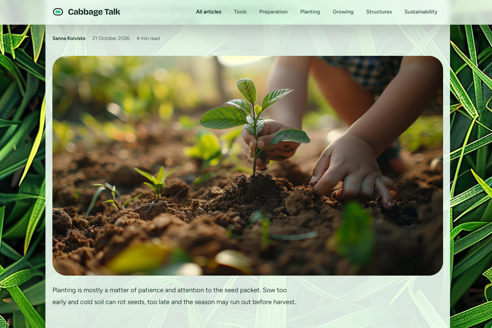

# Cabbage Talk - A Docker Blog Showcase



A showcase gardening blog built with **Next.js 16 (App Router)**, **TypeScript**, **Tailwind CSS 4** and
**PostgreSQL**, packaged for **Docker**. Clean, light theme with an emerald highlight; cover images are cropped into
stadium shapes and the hero has athletics-track lane lines.

## Quick start (Docker)

```bash
docker compose up --build
```

Then open http://localhost:3000.

On first request the app creates the database schema and inserts showcase data
(6 articles with cover images). Data persists in the `pgdata` Docker volume.
To start fresh: `docker compose down -v`.

Optional: copy `.env.example` to `.env` to change the database credentials
(the defaults are for local development only).

## Local development

Run only the database in Docker, and Next.js on your machine:

```bash
docker compose up -d db
cp .env.example .env.local
npm install
npm run dev
```

## How it works

| Concern                                                | Where                                                                       |
| ------------------------------------------------------ | --------------------------------------------------------------------------- |
| Schema + seeding                                       | `src/lib/db.ts` (runs once, guarded by a Postgres advisory lock)            |
| Showcase articles                                      | `src/lib/seed-data.ts`                                                      |
| Queries                                                | `src/lib/queries/index.ts`                                                  |
| Pages                                                  | `src/app/page.tsx`, `src/app/blog/page.tsx`, `src/app/blog/[slug]/page.tsx` |
| Theme (colors and fonts as Tailwind 4 `@theme` tokens) | `src/app/globals.css`                                                       |
| Types                                                  | `src/types/index.ts`                                                        |
| Date formatter                                         | `src/utils/format-date.ts`                                                  |

Article bodies use a tiny format rendered by `src/components/BlogBody.tsx`:
`## Heading`, `- list item`, `> quote`, and plain paragraphs separated by blank lines.

## Adding your own posts

Insert a post directly in PostgreSQL, for example:

```sql
INSERT INTO posts (slug, title, excerpt, content, category, author, cover_image_id)
VALUES ('my-post', 'My post', 'Short summary', E'First paragraph.\n\n## A heading\n\nMore text.', 'Soil', 'Me', 1);
```

## Notes

- Content is sample text for demonstration and is not medical advice.
- Pages are rendered dynamically, so the build does not need a database connection.
